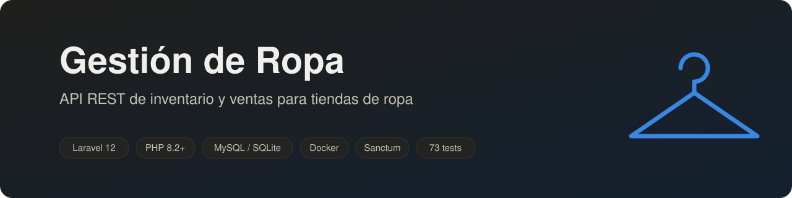
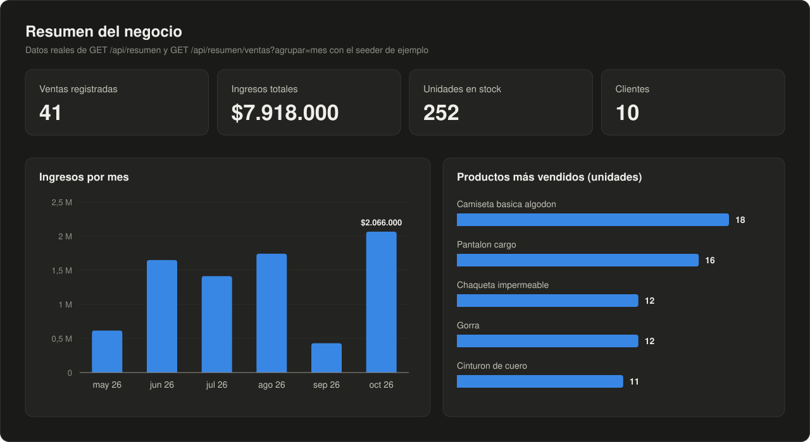
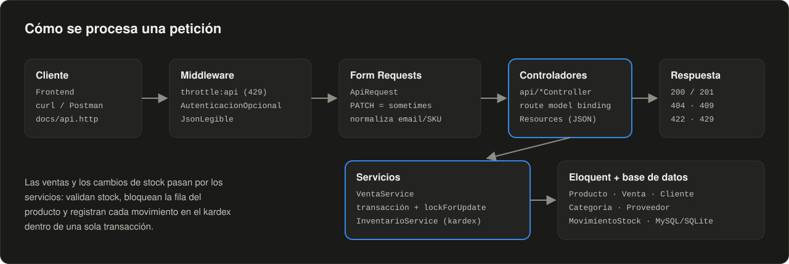
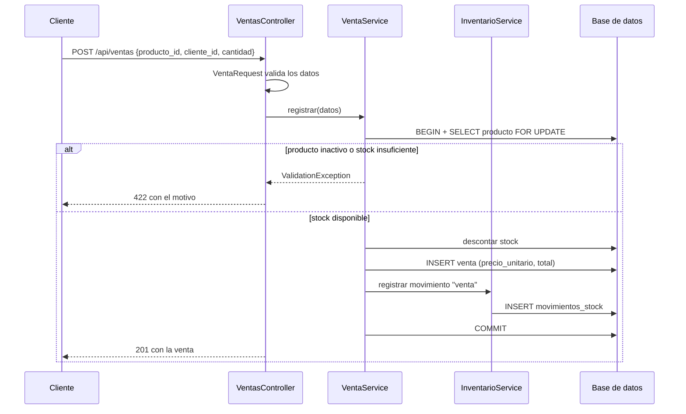
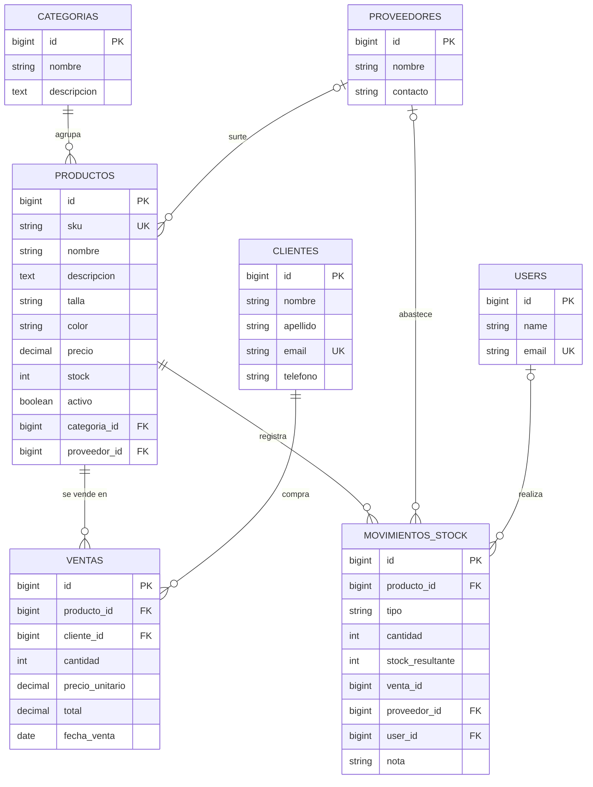
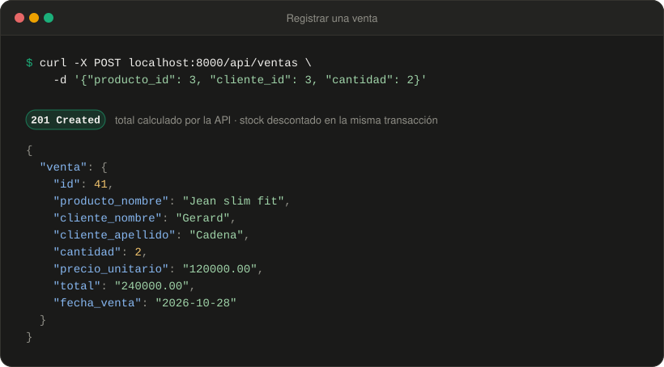
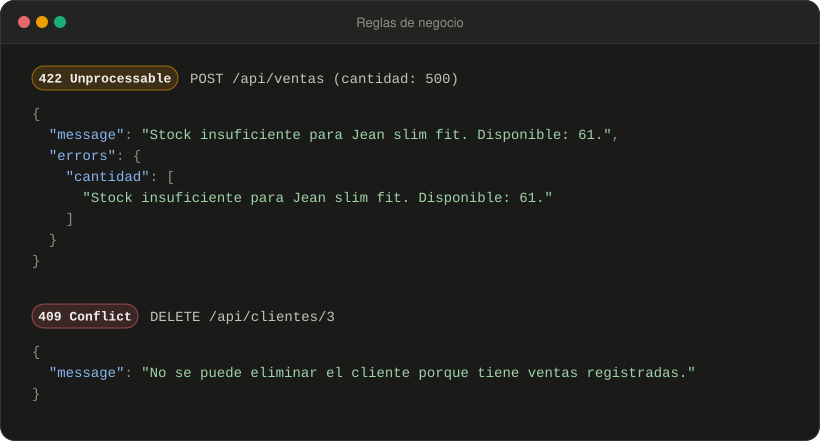
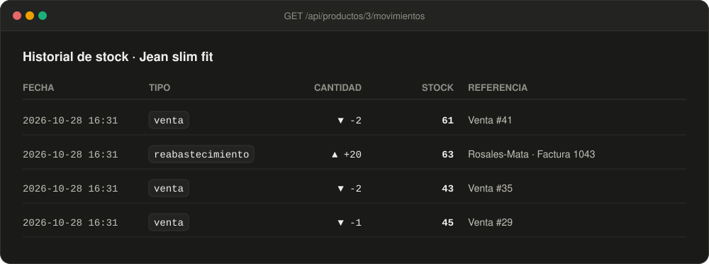

<p align="center">
  
</p>

<p align="center">
  
  
  
  
  
  
  
</p>

<p align="center">
  API REST para administrar el <strong>inventario</strong> y las <strong>ventas</strong> de una tienda de ropa:<br>
  categorías, productos con talla y color, proveedores, clientes, ventas, historial de stock y reportes.
</p>

---

## Contenido

- [¿Qué resuelve?](#qué-resuelve)
- [Vista rápida](#vista-rápida)
- [Características](#características)
- [Arquitectura](#arquitectura)
- [Modelo de datos](#modelo-de-datos)
- [Inicio rápido](#inicio-rápido)
- [Configuración](#configuración)
- [Autenticación](#autenticación)
- [Referencia de la API](#referencia-de-la-api)
- [Ejemplos](#ejemplos)
- [Estructura del proyecto](#estructura-del-proyecto)
- [Tests y calidad](#tests-y-calidad)
- [Licencia](#licencia)

## ¿Qué resuelve?

Una tienda de ropa necesita saber **qué tiene, qué vendió y qué debe reponer**, sin que el stock se descuadre. Esta API se encarga de:

- **Vender sin sobrevender**: cada venta valida y descuenta el stock dentro de una transacción con bloqueo de fila, así dos ventas simultáneas no pueden dejar el stock en negativo.
- **Conservar la historia**: cada venta guarda su precio unitario, no se pueden borrar clientes o productos con ventas y cada movimiento de inventario queda en un kardex.
- **Dar visibilidad**: indicadores del negocio, ventas por día o mes, productos más vendidos, alertas de stock bajo y exportación a Excel.

## Vista rápida

<p align="center">
  
</p>

Datos generados por el seeder de ejemplo y obtenidos de `GET /api/resumen` y `GET /api/resumen/ventas?agrupar=mes`.

<details>
<summary>Ver los datos de la gráfica en tabla</summary>

| Mes | Ventas | Unidades | Ingresos |
| --- | ---: | ---: | ---: |
| may 2026 | 5 | 8 | $616.000 |
| jun 2026 | 7 | 17 | $1.649.000 |
| jul 2026 | 9 | 19 | $1.414.000 |
| ago 2026 | 7 | 16 | $1.743.000 |
| sep 2026 | 5 | 10 | $430.000 |
| oct 2026 | 8 | 19 | $2.066.000 |

</details>

## Características

**Inventario**
- Productos con **SKU**, **talla**, **color**, categoría y proveedor.
- **Historial de movimientos (kardex)**: ventas, ediciones, anulaciones, reabastecimientos y ajustes, con el stock resultante y quién lo hizo.
- **Reabastecimiento** con proveedor y nota (por ejemplo, el número de factura).
- Productos **activos o descontinuados**: los inactivos no se pueden vender ni generan alertas.

**Ventas**
- **Control de stock** transaccional: `422` si no hay unidades suficientes.
- **Total calculado en el servidor** y **precio unitario guardado** en cada venta: editar una venta antigua no la recalcula con el precio actual.
- Editar o anular una venta devuelve el stock correspondiente.

**Reportes**
- Indicadores generales, **productos más vendidos** y **stock bajo**.
- **Ventas por día o mes** con los periodos vacíos incluidos, listas para graficar.
- **Exportación a CSV** compatible con Excel.

**API**
- CRUD completo con `PUT` y **`PATCH` parcial**.
- Validación con **mensajes en español** y normalización (email en minúsculas, SKU y talla en mayúsculas).
- **Filtros**, **paginación opcional** y **límite de peticiones**.
- **Autenticación opcional** con tokens de Laravel Sanctum.
- Errores siempre en JSON: `404`, `409`, `422`, `429`.

**Desarrollo**
- **Docker** con MySQL 8.4: un comando y la API queda funcionando con datos de ejemplo.
- **73 tests** de integración, estilo con Laravel Pint y dependencias sin vulnerabilidades conocidas (`composer audit`).

## Arquitectura

<p align="center">
  
</p>

Flujo de una venta:



## Modelo de datos



## Inicio rápido

### Con Docker (recomendado)

Solo necesitas [Docker](https://www.docker.com/):

```bash
git clone https://github.com/zemogc/Gesti-nRopa.git
cd Gesti-nRopa
docker compose up -d --build
```

Al arrancar, el contenedor genera la `APP_KEY`, espera a MySQL, ejecuta las migraciones y carga los datos de ejemplo. La API queda en **http://localhost:8000/api**.

| Servicio | Dirección | Credenciales |
| --- | --- | --- |
| API | `http://localhost:8000/api` | usuario de prueba `test@example.com` / `password` |
| MySQL | `localhost:3307` | base `gestion_ropa`, usuario `gestion`, contraseña `gestion` |

Comandos útiles:

```bash
docker compose exec app composer test                     # ejecutar los tests
docker compose exec app php artisan migrate:fresh --seed  # reiniciar los datos de ejemplo
docker compose logs -f app                                # ver los logs
docker compose down                                       # detener (los datos se conservan)
docker compose down -v                                    # detener y borrar la base
```

### Sin Docker

Requisitos: **PHP 8.2+** (extensiones `pdo_sqlite` o `pdo_mysql`) y **Composer 2**.

```bash
git clone https://github.com/zemogc/Gesti-nRopa.git
cd Gesti-nRopa
composer install
cp .env.example .env
php artisan key:generate
touch database/database.sqlite
php artisan migrate --seed
php artisan serve
```

Por defecto se usa SQLite. Para usar MySQL, ajusta en `.env` las variables `DB_CONNECTION=mysql`, `DB_HOST`, `DB_PORT`, `DB_DATABASE`, `DB_USERNAME` y `DB_PASSWORD`.

## Configuración

| Variable | Por defecto | Descripción |
| --- | --- | --- |
| `API_REQUIERE_AUTH` | `false` | Si es `true`, todos los endpoints exigen un token Bearer. |
| `API_LIMITE_POR_MINUTO` | `120` | Peticiones por minuto por usuario o IP; al superarlo se responde `429`. |
| `APP_LOCALE` | `es` | Idioma de los mensajes de validación. |

## Autenticación

La autenticación viene **desactivada** para no romper a los clientes existentes. Para activarla, define `API_REQUIERE_AUTH=true`.

1. Crea un usuario (la contraseña se pide de forma interactiva si omites `--password`):

   ```bash
   php artisan usuario:crear "Admin" admin@tienda.com
   ```

2. Obtén un token:

   ```bash
   curl -X POST http://localhost:8000/api/auth/login \
     -H "Content-Type: application/json" \
     -d '{"email": "admin@tienda.com", "password": "tu-contrasena"}'
   ```

   ```json
   { "token": "1|abc...", "tipo": "Bearer", "usuario": { "id": 1, "name": "Admin" } }
   ```

3. Envía el token en cada petición: `Authorization: Bearer <token>`. Para revocarlo usa `POST /api/auth/logout`.

El login admite 5 intentos por minuto.

## Referencia de la API

Todas las rutas tienen el prefijo `/api`. En [docs/api.http](docs/api.http) hay peticiones listas para la extensión **REST Client** de VS Code.

### Recursos

`categorias`, `productos`, `clientes`, `proveedores` y `ventas` exponen las operaciones REST estándar:

| Método | Ruta | Acción |
| --- | --- | --- |
| `GET` | `/{recurso}` | Listar (con filtros y paginación opcional) |
| `POST` | `/{recurso}` | Crear (`201`) |
| `GET` | `/{recurso}/{id}` | Ver detalle |
| `PUT` | `/{recurso}/{id}` | Actualizar (todos los campos) |
| `PATCH` | `/{recurso}/{id}` | Actualizar solo los campos enviados |
| `DELETE` | `/{recurso}/{id}` | Eliminar (`409` si tiene registros asociados) |

### Endpoints adicionales

| Método | Ruta | Acción |
| --- | --- | --- |
| `POST` | `/productos/{id}/reabastecer` | Suma `cantidad` al stock; opcionales `proveedor_id` y `nota` |
| `GET` | `/productos/{id}/movimientos` | Historial de stock del producto (filtro `tipo`) |
| `GET` | `/ventas/exportar` | Descarga las ventas en CSV (acepta los filtros del listado) |
| `GET` | `/resumen` | Indicadores: totales, ingresos, stock bajo y más vendidos |
| `GET` | `/resumen/ventas` | Ventas, unidades e ingresos agrupados por día o mes |
| `POST` | `/auth/login` | Obtener un token |
| `POST` | `/auth/logout` | Revocar el token actual |
| `GET` | `/user` | Usuario autenticado |

### Campos y validaciones

| Recurso | Obligatorios | Opcionales |
| --- | --- | --- |
| Categorías | `nombre` (único, máx. 50), `descripcion` | |
| Productos | `nombre`, `descripcion`, `precio` (≥ 0), `categoria_id`, `stock` (entero ≥ 0) | `sku` (único; letras, números, `-` y `_`), `talla`, `color`, `proveedor_id`, `activo` (por defecto `true`) |
| Clientes | `nombre`, `apellido`, `email` (único), `telefono` (dígitos, espacios, `+`, `-`, `()`) | |
| Proveedores | `nombre`, `contacto` | |
| Ventas | `producto_id`, `cliente_id`, `cantidad` (≥ 1) | `fecha_venta` (no futura; por defecto hoy) |

- En ventas, `total` y `precio_unitario` **no se envían**: los calcula la API.
- El `email` se guarda en minúsculas y `sku` y `talla` en mayúsculas, así `Ana@Mail.com` y `ana@mail.com` cuentan como el mismo email.

### Filtros y paginación

| Ruta | Parámetros |
| --- | --- |
| `GET /productos` | `buscar` (nombre o SKU), `categoria_id`, `proveedor_id`, `talla`, `color`, `activo` (`1`/`0`), `stock_bajo` (ej. `5`) |
| `GET /clientes` | `buscar` (nombre, apellido o email) |
| `GET /ventas` y `/ventas/exportar` | `cliente_id`, `producto_id`, `desde`, `hasta` (`YYYY-MM-DD`) |
| `GET /productos/{id}/movimientos` | `tipo` |
| `GET /resumen` | `stock_minimo` (por defecto `5`) |
| `GET /resumen/ventas` | `agrupar` (`dia` o `mes`), `desde`, `hasta`; por defecto últimos 30 días o 12 meses |

Todos los listados aceptan `por_pagina` (máx. 100) y `pagina`. Sin `por_pagina` se devuelve la lista completa; con paginación se agrega:

```json
"paginacion": { "pagina_actual": 1, "por_pagina": 10, "total": 42, "ultima_pagina": 5 }
```

### Historial de stock

Tipos de movimiento: `inicial`, `venta`, `edicion_venta`, `anulacion`, `reabastecimiento` y `ajuste` (cambio directo del campo `stock` con `PUT` o `PATCH`). La `cantidad` es positiva si entra mercancía y negativa si sale.

### Códigos de respuesta

| Código | Cuándo |
| --- | --- |
| `200` | Consulta, actualización o eliminación correcta |
| `201` | Registro creado |
| `401` | Falta el token (solo con `API_REQUIERE_AUTH=true`) |
| `404` | El recurso no existe |
| `409` | No se puede eliminar: tiene ventas o productos asociados |
| `422` | Datos inválidos, stock insuficiente o producto inactivo |
| `429` | Se superó el límite de peticiones |

## Ejemplos

Todas las respuestas de esta sección son reales, obtenidas de la API corriendo en Docker.

### Registrar una venta

<p align="center">
  
</p>

### Reglas de negocio

Una venta que supera el stock disponible se rechaza con `422`, y un cliente con ventas no se puede eliminar (`409`):

<p align="center">
  
</p>

### Historial de stock de un producto

<p align="center">
  
</p>

### Más ejemplos con curl

```bash
# Productos talla M en color negro
curl "http://localhost:8000/api/productos?talla=M&color=Negro"

# Cambiar solo el teléfono de un cliente
curl -X PATCH http://localhost:8000/api/clientes/1 \
  -H "Content-Type: application/json" -d '{"telefono": "311 222 3344"}'

# Ingresar mercancía
curl -X POST http://localhost:8000/api/productos/1/reabastecer \
  -H "Content-Type: application/json" -d '{"cantidad": 20, "proveedor_id": 1, "nota": "Factura 1043"}'

# Descontinuar un producto
curl -X PATCH http://localhost:8000/api/productos/1 \
  -H "Content-Type: application/json" -d '{"activo": false}'

# Ventas por mes y exportación a Excel
curl "http://localhost:8000/api/resumen/ventas?agrupar=mes"
curl -o ventas.csv "http://localhost:8000/api/ventas/exportar?desde=2026-01-01"
```

## Estructura del proyecto

```
app/
├── Http/
│   ├── Controllers/api/      # Controladores REST, reportes y autenticación
│   ├── Middleware/           # Autenticación opcional y JSON legible
│   ├── Requests/             # Validación por recurso (ApiRequest como base)
│   └── Resources/            # Formato JSON de productos y ventas
├── Models/                   # Categoria, Producto, Cliente, Proveedor, Venta, MovimientoStock
└── Services/
    ├── InventarioService.php # Historial de movimientos de stock
    └── VentaService.php      # Ventas con control de stock
config/gestion.php            # Opciones propias de la API
database/
├── factories/                # Datos falsos para tests y seeder
├── migrations/
└── seeders/                  # Catálogo de ropa de ejemplo
docker/entrypoint.sh          # Arranque del contenedor
docs/
├── api.http                  # Peticiones de ejemplo
└── img/                      # Imágenes de este README
lang/es/                      # Mensajes de validación en español
tests/Feature/                # Tests de integración
```

## Tests y calidad

```bash
composer test    # PHPUnit: 73 tests de integración (SQLite en memoria)
composer lint    # Laravel Pint
composer audit   # vulnerabilidades conocidas en dependencias
```

Los tests siempre usan SQLite en memoria, también dentro de Docker, así que nunca tocan la base de desarrollo. Cubren el CRUD de cada recurso, validaciones, el control de stock en ventas (incluido el cambio de producto y el precio histórico), el kardex, los reportes, la exportación CSV, la autenticación, la paginación y el límite de peticiones.

## Licencia

Distribuido bajo la licencia [MIT](LICENSE).
